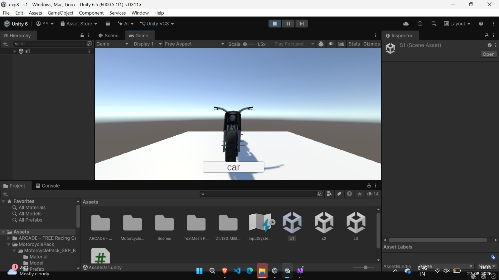
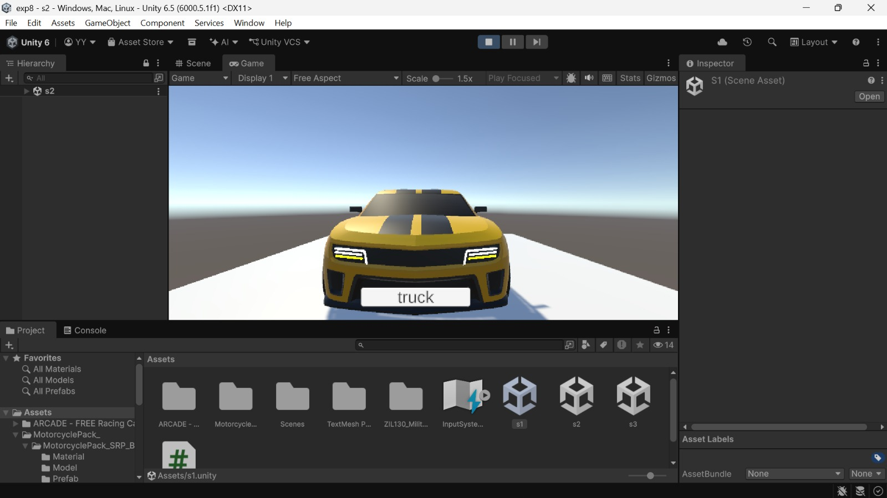
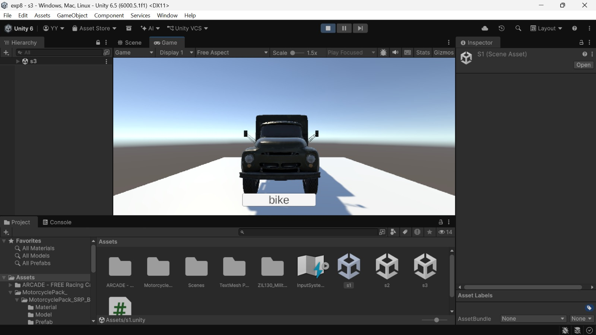

<div align="center">
<samp><b>UNITY SCENE CHANGER</b></samp>

<samp>unity · c# · scene management · ui</samp>

<samp>**[Repository](https://github.com/yo5on/Unity)**</samp>

</div>

---

<div align="center"><samp>A simple Unity project demonstrating scene switching using C#. It contains three scenes featuring different vehicles, with buttons used to switch between scenes.</samp></div>

<h2 align="center"><samp><b>Features</b></samp></h2>

- Scene switching using C#
- Motorcycle scene
- Car scene
- Truck scene
- Simple UI buttons for navigation

<h2 align="center"><samp><b>Technologies</b></samp></h2>

- Unity 6.5.1f1 (`6000.5.1f1`), as recorded in `ProjectSettings/ProjectVersion.txt`
- C#
- Unity Scene Management

<h2 align="center"><samp><b>Output</b></samp></h2>

<h3 align="center"><samp><b>Scene 1 — Motorcycle</b></samp></h3>

<samp>The first scene displays a motorcycle with a button to switch to the next scene.</samp>



<h3 align="center"><samp><b>Scene 2 — Car</b></samp></h3>

<samp>The second scene displays a car with a button to switch to the truck scene.</samp>



<h3 align="center"><samp><b>Scene 3 — Truck</b></samp></h3>

<samp>The third scene displays a truck with a button to return to the motorcycle scene.</samp>



<h2 align="center"><samp><b>How to Run</b></samp></h2>

1. Clone this repository.
2. Open Unity Hub.
3. Add or open this project.
4. Open `Assets/s1.unity` for the motorcycle scene, `Assets/s2.unity` for the car scene, or `Assets/s3.unity` for the truck scene.
5. Press Play.
6. Use the buttons to switch between scenes.

<h2 align="center"><samp><b>Project Structure</b></samp></h2>

```text
Assets/           Game assets and C# scripts
Packages/         Unity package configuration
ProjectSettings/  Unity project settings
```

<h2 align="center"><samp><b>Author</b></samp></h2>

<div align="center">

<samp><strong>Yoson</strong> · software, AI/ML and interactive projects</samp>

<samp><a href="https://github.com/yo5on">github.com/yo5on</a> · <a href="https://www.linkedin.com/in/yo5on">LinkedIn</a></samp>

</div>
